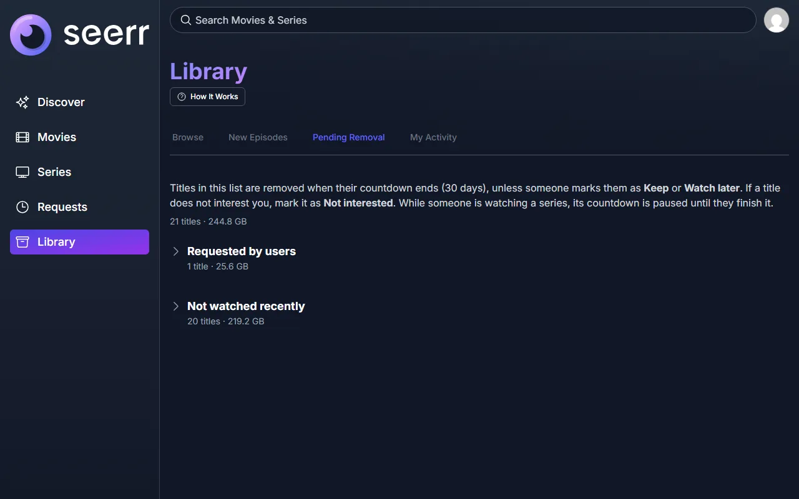
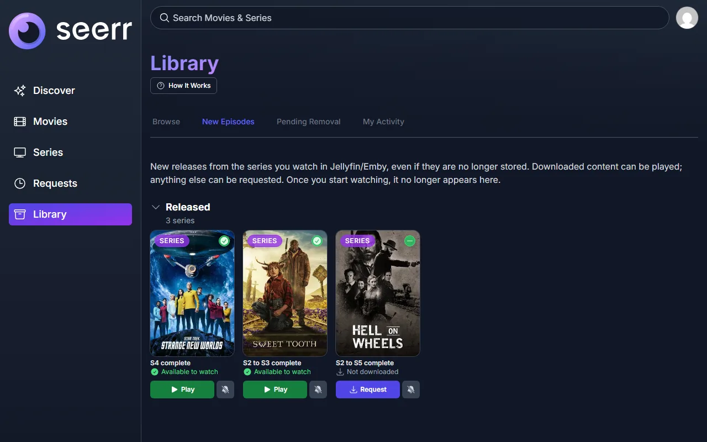

<p align="center">

</p>

# Seerr Library

A fork of [Seerr](https://github.com/seerr-team/seerr) that adds a **Library** module for Jellyfin and Emby servers.

Seerr manages what comes into your library. This fork also manages what leaves it: on a shared server, users rarely tell anyone they have finished with something, so disks fill up with titles nobody will watch again. Library lets users vote on what they no longer need, queues titles nobody watches, gives every queued title a visible countdown so anyone can keep it, and removes it through Radarr/Sonarr when the countdown ends. It also tells each user when new episodes of the shows they follow are available.

Everything else is upstream Seerr, unchanged.

## What this fork adds

- **Browse**: the whole library, movies and individual seasons, with filters, size on disk, last playback and the reason a title is queued.
- **Votes**: each user can mark a title _Not interested_, _Watch later_ or _Request removal_. Users with the Keep permission can mark it _Keep_, which takes it out of the queue.
- **Pending Removal**: titles that will be removed, each with its countdown. A title enters the queue when a user requests its removal, when enough users are not interested, when nobody has played it for a configurable number of months, or when an administrator adds it.
- **Pause while watching**: a queued season stops its countdown while someone is watching it.
- **New Episodes**: for every show a user has been watching, the episodes and seasons released since they last watched, with links to play or request them. It keeps working after older seasons have been removed.
- **Removal execution**, configurable:
  - **Notify only**: nothing is removed; the Removal History records what would have been.
  - **Remove with Radarr/Sonarr**: Seerr removes movies and single seasons itself, once a day.
  - **External executor**: your own program removes titles through a documented [API](docs/library/external-executor.md).
- **Torrents** (optional qBittorrent connection): keep them, remove them, or remove them once a minimum seeding ratio or time is reached.
- **My Activity**, **Removal History** and a guided **How It Works** tour for new users.
- English and Spanish translations.

<p align="center">


</p>

Full documentation: [docs/library](docs/library/README.md).

## Requirements

- Seerr with **Jellyfin or Emby**. Plex is not supported: playback history is read from Jellyfin/Emby.
- **SQLite** database (the default). PostgreSQL is not supported by the module.
- **Radarr and/or Sonarr** configured in Seerr.
- **qBittorrent**, optional.

## Installation

No prebuilt image is published. Build it from this repository:

```sh
git clone https://github.com/Danielcurly/seerr-library.git
cd seerr-library
docker build --build-arg COMMIT_TAG=library -t seerr-library .
```

Then run it exactly like Seerr (port 5055, configuration in `/app/config`), replacing the image name. See the [Seerr documentation](https://docs.seerr.dev/getting-started/) for the rest of the options.

**Switching from Seerr**: use your existing configuration folder. The module adds its own tables on first start and does not change existing data, but **back up the configuration folder first**. Then open **Library > Settings** as an administrator; new installations start in _Notify only_.

## Other changes from upstream

- When a request updates a series that already exists in Sonarr, Seerr also applies the _Monitor new items_ setting of that Sonarr server. Upstream applies it only when the series is first added.

## About Seerr

**Seerr** is a free and open source application for managing requests for your media library. It integrates with [Jellyfin](https://jellyfin.org), [Plex](https://plex.tv) and [Emby](https://emby.media/), and with services such as [Sonarr](https://sonarr.tv/) and [Radarr](https://radarr.video/).

- Upstream repository: https://github.com/seerr-team/seerr
- Documentation: https://docs.seerr.dev
- This fork is based on Seerr v3.5.0.

Please report problems with the Library module in this repository, not upstream.

## License

MIT, like upstream Seerr. See [LICENSE](./LICENSE).
